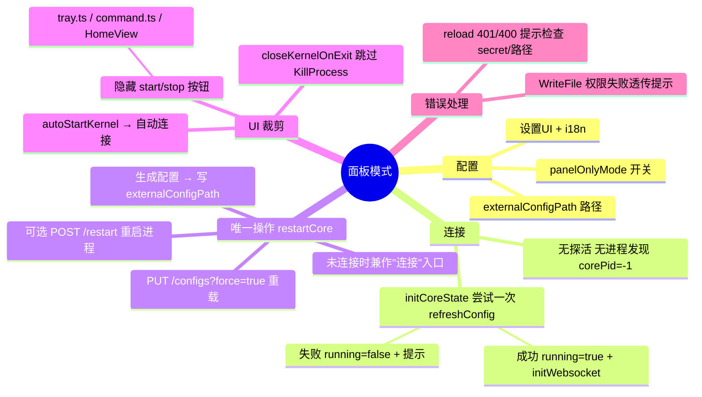

###

[新增面板功能](https://deepwiki.com/search/d2c111cd-f726-430d-b37f-9c59839aff7c?mode=deep)

# DeepWiki Q&A with Code Context for Repository: GUI-for-Cores/GUI.for.Clash
## Q1
接管 init.d 已运行的 mihomo或者window中clash（仅做面板） 
要求：
1. linux系统中自动寻找mihomo进程id，windows系统中查找clash进程id，进程重启后，自动更新
2.  GUI 的 profile配置中可以配置1中进程使用的配置文件路径
3. 使用2的配置中的api和secret管理
4. GUI 生成的 data/mihomo/config.yaml同步到2配置的路径
5. 以上作为一个开关，关闭情况下使用默认（原来）的逻辑，打开仅作为面板
### Answer
The user wants to understand how to implement "panel-only" mode: attach to an already-running mihomo/clash process instead of launching one. Need to explore codebase: kernel management, process spawning, config generation, API client.Need a bit more: generateConfigFile location, ProcessInfo bridge impl, profile type. Search quickly.Read generator.ts around 401, constant/kernel.ts 14-18, exec.go 160-240, helper.ts 423.I have enough context. The user asks (in Chinese) about taking over an already-running mihomo/clash process — panel-only mode. This is a feature request / "how to implement" question. Ask-only mode: explain conceptually what needs to change, no plan. Answer in Chinese, concise, with citations.这个功能（"仅作面板"模式）在当前代码里不存在，需要新增。下面按你的 5 条要求说明现状和需要改动的位置。

## 现状

- 内核生命周期由 `useKernelApiStore` 管理：`startCore` → `generateConfigFile` 写 `data/mihomo/config.yaml` → `runCoreProcess` 通过 `ExecBackground` 拉起进程并写 `pid.txt` → `onCoreStarted` 初始化 websocket 和配置。 GUI.for.Clash:228-248 
- `initCoreState` 目前只认 `pid.txt` 里记录的 PID，且要求进程名以 `mihomo` 开头；找不到就走 `autoStartKernel` 自己启动。 GUI.for.Clash:127-141 
- API 地址和 secret 已经是从 profile 的 `advancedConfig['external-controller']` / `advancedConfig.secret` 读取的（`setupCoreApi`），所以"用配置中的 api 和 secret 管理"这一点天然支持，只要外部进程的 controller/secret 与 profile 一致即可。 GUI.for.Clash:68-89 
- 配置生成固定在 `generateConfigFile`，只写 `CoreConfigFilePath`（`data/mihomo/config.yaml`）。 GUI.for.Clash:401-411 GUI.for.Clash:14-18 

## 需要新增的内容

**1. 进程发现（要求 1）**
- bridge 层需要新增一个"按进程名找 PID"的方法。现有 `ProcessInfo(pid)` 是 PID→名称，方向相反。 GUI.for.Clash:160-170 可以用 `gopsutil` 的 `process.Processes()` 遍历匹配 `mihomo`（Linux）/`clash`/`mihomo`（Windows），返回 PID 列表。
- 前端在面板模式下轮询该方法（或监听 API `/version` 探活失败）来检测进程重启并更新 `corePid`。注意：进程重启后 PID 变化，但 API 连接本身不需要 PID——`corePid` 主要用于 `stopCore` 的 `KillProcess` 和 `ProcessMemory`。 GUI.for.Clash:250-261 

**2. Profile 增加外部配置路径（要求 2）**
- 在 `App.Profile` 类型和 `AdvancedConfigDefaults`（或 profile 顶层）加字段，如 `externalConfigPath`，并在 `AdvancedConfig.vue` 加输入项。 GUI.for.Clash:34-40 GUI.for.Clash:32-35 

**3. API/secret（要求 3）**
- 无需改动，`setupCoreApi` 已按 profile 读取。 GUI.for.Clash:74-80 但要注意：面板模式下生成配置里的 `external-controller`/`secret` 必须与外部进程实际使用的一致，否则连不上。

**4. 配置同步（要求 4）**
- `generateConfigFile` 目前只写 `CoreConfigFilePath`。面板模式下需额外 `WriteFile` 到 `externalConfigPath`（或改为写入该路径而非默认路径）。 GUI.for.Clash:405-410 外部 mihomo 不会自动 reload，还需调用 `PUT /configs?force=true`（`Api.Configs` 已有 PATCH，需补一个带 `path` 参数的 reload 接口）让运行中的进程加载新配置。 GUI.for.Clash:24-35 

**5. 开关（要求 5）**
- 在 `appSettingsStore.app` 加开关（如 `panelOnlyMode`）。开启时：
  - `initCoreState`/`startCore` 跳过 `ExecBackground`，改为"发现进程 → 探活 `/version` → `onCoreStarted(pid)`"；
  - `stopCore` 应改为"断开连接"而非 `KillProcess`（否则会把别人的进程杀掉）；
  - `restartCore`、TUN 等待逻辑、系统代理自动设置等也要相应跳过或保留，需逐项确认。 GUI.for.Clash:143-200 

## 需要注意的坑

- `isCoreStartedByThisInstance` 已区分"是否本实例启动"，面板模式可复用这个标记来决定 `stopCore` 是否真的杀进程。 GUI.for.Clash:124-125 
- Linux init.d 启动的 mihomo 可能是 root 权限，`ProcessInfo`/websocket 读取没问题，但 `KillProcess` 和写其配置路径可能受权限限制。
- Windows 上 "clash" 进程名不唯一（clash-verge、clashx 等），建议按可执行名 + 端口探活双重确认，而不是只匹配进程名。

如果你要我给出具体实现方案（改哪些文件、新增哪些 bridge 方法），可以告诉我，我可以整理成可执行的开发计划。
### Citations
**File:** frontend/src/stores/kernelApi.ts (L124-125)
```typescript
  let isCoreStartedByThisInstance = false
  let { promise: coreStoppedPromise, resolve: coreStoppedResolver } = Promise.withResolvers()
```
**File:** frontend/src/stores/kernelApi.ts (L127-141)
```typescript
  const initCoreState = async () => {
    corePid.value = Number(await ReadFile(CorePidFilePath).catch(() => -1))
    const processName = corePid.value === -1 ? '' : await ProcessInfo(corePid.value).catch(() => '')
    running.value = processName.startsWith('mihomo')

    coreStateLoading.value = false

    if (running.value) {
      initWebsocket()
      await Promise.all([refreshConfig(), refreshProviderProxies()])
      await envStore.updateSystemProxyStatus()
    } else if (appSettingsStore.app.autoStartKernel) {
      await startCore()
    }
  }
```
**File:** frontend/src/stores/kernelApi.ts (L143-200)
```typescript
  const runCoreProcess = async (isAlpha: boolean, tunEnabled: boolean) => {
    let stopped = false
    const pid = await ExecBackground(
      CoreWorkingDirectory + '/' + getKernelFileName(isAlpha),
      getKernelRuntimeArgs(isAlpha),
      undefined,
      async (end) => {
        stopped = true
        const logs = await ReadFile(CoreLogFilePath, { Range: '-4096' }).catch((err) => String(err))
        logs.split('\n').forEach((line) => line && logsStore.recordKernelLog(line))
        end && logsStore.recordKernelLog(end)
        onCoreStopped()
      },
      {
        PidFile: CorePidFilePath,
        LogFile: CoreLogFilePath,
        Env: getKernelRuntimeEnv(isAlpha),
      },
    )
    while (!stopped) {
      const ok = await probeApiAvailability().catch(() => false)
      if (ok) break
      if (stopped) throw 'Startup failed. Check logs for details.'
      await sleep(500)
    }
    const start = Date.now()
    while (tunEnabled) {
      const config = await getConfigs().catch(() => null)
      if (config?.tun?.enable) break
      if (Date.now() - start >= 5_000) {
        message.warn('TUN mode startup timed out.')
        break
      }
      await sleep(500)
    }
    return pid
  }

  const onCoreStarted = async (pid: number) => {
    corePid.value = pid
    running.value = true
    needRestart.value = false
    isCoreStartedByThisInstance = true
    coreStoppedPromise = new Promise((r) => (coreStoppedResolver = r))

    initWebsocket()
    await Promise.all([refreshConfig(), refreshProviderProxies()])

    if (appSettingsStore.app.autoSetSystemProxy) {
      await envStore.setSystemProxy().catch((err) => message.error(err))
    }
    if (appSettingsStore.app.autoSetSystemDNS) {
      await envStore.setSystemDNS(true).catch((err) => message.error(err))
    }
    await envStore.updateSystemProxyStatus()

    await pluginsStore.onCoreStartedTrigger()
  }
```
**File:** frontend/src/stores/kernelApi.ts (L228-248)
```typescript
  const startCore = async () => {
    if (running.value) throw 'The core is already running'

    logsStore.clearKernelLog()

    const { profile: profileID, branch } = appSettingsStore.app.kernel
    const profile = profilesStore.getProfileById(profileID)
    if (!profile) throw 'Choose a profile first'

    starting.value = true
    try {
      await generateConfigFile(profile, (config) =>
        pluginsStore.onBeforeCoreStartTrigger(config, profile),
      )
      const isAlpha = branch === Branch.Alpha
      const pid = await runCoreProcess(isAlpha, profile.tunConfig.enable)
      pid && (await onCoreStarted(pid))
    } finally {
      starting.value = false
    }
  }
```
**File:** frontend/src/stores/kernelApi.ts (L250-261)
```typescript
  const stopCore = async () => {
    if (!running.value) throw 'The core is not running'

    stopping.value = true
    try {
      await pluginsStore.onBeforeCoreStopTrigger()
      await KillProcess(corePid.value)
      await (isCoreStartedByThisInstance ? coreStoppedPromise : onCoreStopped())
    } finally {
      stopping.value = false
    }
  }
```
**File:** frontend/src/api/kernel.ts (L24-35)
```typescript
export enum Api {
  Configs = '/configs',
  Memory = '/memory',
  Proxies = '/proxies',
  Providers = '/providers/proxies',
  ProxyDelay = '/proxies/{0}/delay',
  ProviderProxyDelay = '/providers/proxies/{0}/{1}/healthcheck',
  Connections = '/connections',
  Traffic = '/traffic',
  Logs = '/logs',
  GEO = '/configs/geo',
}
```
**File:** frontend/src/api/kernel.ts (L68-89)
```typescript
const setupCoreApi = (protocol: 'http' | 'ws') => {
  const { currentProfile: profile } = useProfilesStore()

  let base = `${protocol}://127.0.0.1:20113`
  let bearer = ''

  if (profile) {
    const controller = profile.advancedConfig['external-controller'] || '127.0.0.1:20113'
    const { host, port } = resolveController(controller, 20113)
    // TODO: tls
    base = `${protocol}://${formatProxyHost(host)}:${port}`
    bearer = profile.advancedConfig.secret
  }

  if (protocol === 'http') {
    request.base = base
    request.bearer = bearer
  } else {
    websocket.base = base
    websocket.bearer = bearer
  }
}
```
**File:** frontend/src/utils/generator.ts (L401-411)
```typescript
export const generateConfigFile = async (
  profile: App.Profile,
  beforeWrite: (config: any) => Promise<any>,
) => {
  const header = `# DO NOT EDIT - Generated by ${APP_TITLE}\n`

  const _config = await generateConfig(profile)
  const config = await beforeWrite(_config)

  await WriteFile(CoreConfigFilePath, header + stringifyNoFolding(config))
}
```
**File:** frontend/src/constant/kernel.ts (L14-18)
```typescript
export const CoreWorkingDirectory = 'data/mihomo'
export const CorePidFilePath = CoreWorkingDirectory + '/pid.txt'
export const CoreLogFilePath = CoreWorkingDirectory + '/mihomo.log'
export const CoreConfigFilePath = CoreWorkingDirectory + '/config.yaml'
export const CoreCacheFilePath = CoreWorkingDirectory + '/cache.db'
```
**File:** bridge/exec.go (L160-170)
```go
func (a *App) ProcessInfo(pid int32) FlagResult {
	log.Printf("ProcessInfo: %d", pid)

	proc, err := process.NewProcess(pid)
	if err != nil {
		return FlagResult{false, err.Error()}
	}

	name, err := proc.Name()
	if err == nil && name != "" {
		return FlagResult{true, name}
```
**File:** frontend/src/constant/profile.ts (L34-40)
```typescript
export const AdvancedConfigDefaults = (): App.Profile['advancedConfig'] => ({
  port: 0,
  'socks-port': 0,
  secret: generateSecureKey(),
  'external-controller': '127.0.0.1:20113',
  'external-ui': '',
  'keep-alive-interval': 30,
```
**File:** frontend/src/views/ProfilesView/components/AdvancedConfig.vue (L32-35)
```vue
  <div class="form-item">
    {{ t('kernel.external-controller') }}
    <Input v-model="fields['external-controller']" placeholder="127.0.0.1:9090" editable />
  </div>
```
## Q2
很好，继续完善 1. restartCore、TUN 等待逻辑、系统代理自动设置保留 2. 都用监听 API /version 探活 3. 是否需要查找和更新PID，根据面板模式是否需要查看内存占用决定 4. 同步新配置后使用PUT /configs?force=true重新加载 5. stopCore 应改为"断开连接“，不能杀死系统进程 6. 写其配置路径可能受权限限制失败提示给出具体实现方案
### Answer
User wants a concrete implementation plan. Ask-only mode says don't create plans... but instructions say when user wants implementation, include <plan>. The "Ask-only mode" section says do NOT create plans. But the plan format section says include plan when user wants work done. Conflict: ask-only mode explicitly says "Do NOT create plans or suggest implementation steps... explain conceptually". So give detailed conceptual implementation, no <plan>.

Need a bit more detail: check kernelApi.ts full file, api/kernel.ts for PUT configs, bridge methods list. Let me read key files quickly.Need a few more details: where memory usage is displayed (ProcessMemory?), app settings type, where generateConfigFile called elsewhere, bridge methods for finding process. Quick greps.Check OverView.vue memory usage and bridge exec ProcessMemory quickly, plus appSettings type around line 80.I have enough. Write the concrete implementation plan in Chinese, conceptual (ask-only mode — no <plan>). Cover the 6 points.下面是具体实现方案，按你的 6 点要求组织。

## 1. 新增配置项

**`frontend/src/types/app.d.ts`** — 在 `app.kernel` 下加：

```ts
kernel: {
  // ...existing
  panelOnlyMode: boolean        // 仅作面板开关
  externalConfigPath: string    // 外部进程使用的配置文件路径
}
```

**`frontend/src/stores/appSettings.ts`**（约 line 86 附近默认值处）加 `panelOnlyMode: false, externalConfigPath: ''`。

**设置 UI**：在 `SettingsView/components/components/AdvancedSettings.vue` 或 `BehaviorSettings.vue` 加开关和路径输入框（路径也可放 profile 的 `AdvancedConfig.vue`，但放 app 级更简单——因为 `setupCoreApi` 已经用 `currentProfile` 的 `external-controller`/`secret`，外部路径属于"接管目标"而非 profile 本身）。

## 2. 进程发现（bridge）

**`bridge/exec.go`** 新增方法，用 `gopsutil` 遍历进程：

```go
func (a *App) FindProcessByNames(names []string) FlagResult {
    procs, err := process.Processes()
    // 遍历匹配 proc.Name()，返回第一个匹配的 pid
}
```

前端调用时传 `['mihomo']`（Linux）或 `['mihomo', 'clash', 'clash-verge', 'Clash Verge']`（Windows）。在 `frontend/src/bridge/exec.ts` 加对应封装。

**PID 是否需要的判定**（你的第 3 点）：`corePid` 仅被两处真实使用——`stopCore` 的 `KillProcess`（面板模式禁用）和 `OverView.vue` 的 `ProcessMemory(kernelApiStore.pid)`（仅当 `realMemoryUsage` 开启时）。 GUI.for.Clash:111-119 所以：

- 面板模式下，仅当 `appSettings.app.kernel.realMemoryUsage === true` 时才调用 `FindProcessByNames` 更新 `corePid`；否则 `corePid` 保持 `-1`。
- `getCoreMemoryUsage` 里加保护：`kernelApiStore.pid === -1` 时直接返回 fallback。

## 3. 探活与重连（你的第 2 点）

在 `kernelApi.ts` 新增面板模式的连接循环，替代 `runCoreProcess`：

```ts
const attachToExternalCore = async () => {
  // 循环 probeApiAvailability()（GET /version），成功后：
  // 若 realMemoryUsage → FindProcessByNames 拿 pid，否则 pid = -1
  // 然后走 onCoreStarted(pid)
}
```

**进程重启检测**：启动一个定时器（如每 3s）在 `running.value === true && panelOnlyMode` 时 `probeApiAvailability()`：
- 连续 N 次失败 → 认为进程挂了 → 调 `onCoreStopped()`（不杀进程），然后继续探活；
- 探活恢复 → 重新 `FindProcessByNames` 更新 pid → `onCoreStarted(newPid)`。

这样 PID 自动更新，且 websocket 走 `initWebsocket`/`destroyWebsocket` 重建。 GUI.for.Clash:174-197 

## 4. startCore / stopCore / restartCore 改造

**`startCore`**（line 228-248）：面板模式分支——

```ts
if (panelOnlyMode) {
  await generateConfigFile(profile, ...)   // 仍生成，但写到 externalConfigPath（见第 5 点）
  await reloadExternalConfig()             // PUT /configs?force=true
  await attachToExternalCore()
} else {
  // 原逻辑
}
```

**`stopCore`**（line 250-261）：面板模式下跳过 `KillProcess`，直接 `await onCoreStopped()`。`isCoreStartedByThisInstance` 保持 `false`（`onCoreStarted` 里 line 185 需要改成只在非面板模式置 true），这样 `onCoreStopped` 里 `RemoveFile(CorePidFilePath)` 的分支行为也正确。 GUI.for.Clash:181-226 

**`restartCore`**（line 263-273）：面板模式下语义变为"重新生成配置 + PUT reload + 重新探活"，即 `stopCore`（断开）→ `cleanupTask` → `startCore`（写配置+reload+attach）。TUN 等待逻辑保留——`attachToExternalCore` 里复用 `runCoreProcess` 中 line 168-177 的 TUN 轮询段（抽成 `waitForTun()` 共用）。系统代理/DNS 自动设置保留在 `onCoreStarted` 中不动。 GUI.for.Clash:168-177 

**`initCoreState`**（line 127-141）：面板模式下跳过 `pid.txt`/`ProcessInfo` 检查，直接 `probeApiAvailability()`，成功则 attach；失败且 `autoStartKernel` 则进入探活循环（外部进程可能稍后启动）。

## 5. 配置同步 + reload（你的第 4、6 点）

**`frontend/src/api/kernel.ts`** 新增：

```ts
export const reloadConfigs = (path: string) =>
  request.put<null>(Api.Configs + '?force=true', { path })
```

**`frontend/src/utils/generator.ts`** 的 `generateConfigFile`（line 401-411）改为接受目标路径参数，或在 `kernelApi.ts` 中生成后二次 `WriteFile` 到 `externalConfigPath`。建议后者——`data/mihomo/config.yaml` 照常写（GUI 内部一致性），面板模式额外同步到外部路径。

**权限失败提示**（第 6 点）：`WriteFile` 到外部路径用 try/catch 包裹，失败时 `message.error` 给出具体信息，例如：

```
无法写入配置文件 /etc/mihomo/config.yaml：permission denied。
请检查文件权限，或以 root 运行 GUI / 修改 externalConfigPath。
```

`WriteFile` 的 bridge 错误信息直接透传到提示中。同理 `reloadConfigs` 失败（如外部进程 secret 不匹配返回 401、路径不存在返回 400）也要 catch 并提示"配置已写入但 reload 失败：{err}"。

## 6. 其他需要处理的点

- **`closeKernelOnExit`**（`app.d.ts` line 71）：面板模式下退出 GUI 时不得杀进程，退出逻辑处需加判断。
- **`onCoreStarted` 中 `isCoreStartedByThisInstance = true`**（line 185）：面板模式必须保持 `false`，否则 `stopCore` 会等 `coreStoppedPromise`（永远等不到，因为没有 ExecBackground 回调触发 `onCoreStopped`）。 GUI.for.Clash:250-261 
- **日志**：面板模式没有 `mihomo.log`，`logsStore.clearKernelLog()` 和 `runCoreProcess` 回调里读日志的逻辑跳过；内核日志走 websocket `/logs` 通道即可（`onLogs` 已存在）。
- **i18n**：`frontend/src/lang/locale/zh.ts`、`en.ts` 加 `settings.panelOnlyMode`、`settings.externalConfigPath` 等词条。

## 改动文件清单

| 文件 | 改动 |
|---|---|
| `bridge/exec.go` | 新增 `FindProcessByNames` |
| `frontend/src/bridge/exec.ts` | 封装新方法 |
| `frontend/src/types/app.d.ts` | `panelOnlyMode`、`externalConfigPath` |
| `frontend/src/stores/appSettings.ts` | 默认值 |
| `frontend/src/api/kernel.ts` | `reloadConfigs`（PUT /configs?force=true） |
| `frontend/src/stores/kernelApi.ts` | `attachToExternalCore`、探活定时器、start/stop/restart/init 分支 |
| `frontend/src/utils/generator.ts` | 支持写入外部路径（或在 store 层二次写） |
| `frontend/src/views/HomeView/components/OverView.vue` | `pid === -1` 保护 |
| `AdvancedSettings.vue` / `BehaviorSettings.vue` | 开关 + 路径输入 |
| `zh.ts` / `en.ts` | 文案 |

一个需要你确认的取舍：面板模式下 `restartCore` 无法真正重启外部进程（只能 reload 配置）。`PUT /configs?force=true` 对大多数配置生效，但 `external-controller`、`secret`、tun 设备名等少数字段 reload 后不生效——如果用户改了这些，需要提示"需手动重启外部 mihomo 进程"。
### Citations
**File:** frontend/src/views/HomeView/components/OverView.vue (L111-119)
```vue
let latestCoreMemoryUsageTime: number
const getCoreMemoryUsage = async (fallback: number) => {
  if (latestCoreMemoryUsageTime && Date.now() - latestCoreMemoryUsageTime < 30_000) {
    return fallback
  }
  const useage = await ProcessMemory(kernelApiStore.pid).catch(() => fallback)
  latestCoreMemoryUsageTime = Date.now()
  return useage
}
```
**File:** frontend/src/api/kernel.ts (L174-197)
```typescript
export const initWebsocket = () => {
  Object.values(wsChannels).forEach((channel) => {
    const { connect, disconnect } = websocket.createWS({
      url: channel.url,
      params: channel.params,
      cb: (data) => channel.handlers.forEach((cb) => cb(data)),
    })
    channel.connect = connect
    channel.disconnect = disconnect
    channel.isActive = false
    if (channel.handlers.length > 0) {
      channel.connect()
      channel.isActive = true
    }
  })
}
export const destroyWebsocket = () => {
  Object.values(wsChannels).forEach((channel) => {
    channel.disconnect?.()
    channel.connect = undefined
    channel.disconnect = undefined
    channel.isActive = false
  })
}
```
**File:** frontend/src/stores/kernelApi.ts (L168-177)
```typescript
    const start = Date.now()
    while (tunEnabled) {
      const config = await getConfigs().catch(() => null)
      if (config?.tun?.enable) break
      if (Date.now() - start >= 5_000) {
        message.warn('TUN mode startup timed out.')
        break
      }
      await sleep(500)
    }
```
**File:** frontend/src/stores/kernelApi.ts (L181-226)
```typescript
  const onCoreStarted = async (pid: number) => {
    corePid.value = pid
    running.value = true
    needRestart.value = false
    isCoreStartedByThisInstance = true
    coreStoppedPromise = new Promise((r) => (coreStoppedResolver = r))

    initWebsocket()
    await Promise.all([refreshConfig(), refreshProviderProxies()])

    if (appSettingsStore.app.autoSetSystemProxy) {
      await envStore.setSystemProxy().catch((err) => message.error(err))
    }
    if (appSettingsStore.app.autoSetSystemDNS) {
      await envStore.setSystemDNS(true).catch((err) => message.error(err))
    }
    await envStore.updateSystemProxyStatus()

    await pluginsStore.onCoreStartedTrigger()
  }

  const onCoreStopped = async () => {
    if (!isCoreStartedByThisInstance) {
      await RemoveFile(CorePidFilePath)
    }

    corePid.value = -1
    running.value = false
    needRestart.value = false

    destroyWebsocket()

    await envStore.updateSystemProxyStatus()
    if (envStore.systemProxy) {
      await envStore.clearSystemProxy().catch((err) => message.error(err))
    }
    if (appSettingsStore.app.autoSetSystemDNS || envStore.systemDNSSet) {
      await envStore.setSystemDNS(false).catch((err) => message.error(err))
    }

    resetConfig()

    await pluginsStore.onCoreStoppedTrigger()

    coreStoppedResolver(null)
  }
```
**File:** frontend/src/stores/kernelApi.ts (L250-261)
```typescript
  const stopCore = async () => {
    if (!running.value) throw 'The core is not running'

    stopping.value = true
    try {
      await pluginsStore.onBeforeCoreStopTrigger()
      await KillProcess(corePid.value)
      await (isCoreStartedByThisInstance ? coreStoppedPromise : onCoreStopped())
    } finally {
      stopping.value = false
    }
  }
```
## Q3
说下上述方案的思维导图
### Answer
User wants a mind map of the plan. Provide mermaid mindmap.```mermaid
mindmap
  root((面板模式<br/>panelOnlyMode))
    配置项
      app.kernel.panelOnlyMode 开关
      app.kernel.externalConfigPath 外部配置路径
      appSettings.ts 默认值
      Settings UI 开关+路径输入
      i18n zh/en 文案
    进程发现
      bridge/exec.go FindProcessByNames
        gopsutil 遍历进程名
        Linux: mihomo
        Windows: mihomo/clash/clash-verge
      PID 按需获取
        realMemoryUsage=true 才查 PID
        否则 corePid=-1
        OverView.vue pid=-1 保护
    探活与重连
      probeApiAvailability GET /version
      定时器 3s 轮询
        连续失败 → onCoreStopped 断开
        恢复 → 更新PID → onCoreStarted
      websocket init/destroy 重建
    生命周期改造
      startCore
        面板: 生成配置→写外部路径→PUT reload→attach
        默认: 原 ExecBackground 逻辑
      stopCore
        面板: 跳过 KillProcess 仅断开
      restartCore
        面板: 断开→写配置→reload→重连
      initCoreState
        面板: 跳过 pid.txt 直接探活
      保留逻辑
        TUN 等待 waitForTun 抽取共用
        系统代理/DNS 自动设置
    配置同步
      data/mihomo/config.yaml 照常写
      额外 WriteFile externalConfigPath
      PUT /configs?force=true reload
      权限失败提示
        WriteFile catch 透传错误
        reload 失败 401/400 提示
    注意事项
      isCoreStartedByThisInstance 保持 false
      closeKernelOnExit 不杀外部进程
      无 mihomo.log 日志走 ws /logs
      reload 不生效字段需手动重启提示
        external-controller
        secret
        tun 设备名
```

核心思路一句话：**面板模式 = 跳过进程拉起/杀死，用 `/version` 探活维持连接状态，配置双写 + `PUT /configs?force=true` 热加载，PID 仅在需要显示内存时才查找**。
```
## Q4
再修改目标： 1. 面板模式去掉startCore / stopCore，只保留restartCore（通过api rstart方法） 2. 没有startCore和stopCore后，进程发现和探活可以取消
### Answer
User refines: panel mode removes start/stop, only restartCore via API restart method (mihomo has POST /restart? Actually mihomo API has `POST /restart`? Clash API: `POST /restart` exists in mihomo). No process discovery/probing needed. Need to check if restart API exists in codebase.Need to check kernelApi.ts around 263-273 and 380-420, plus where start/stop buttons are (HomeView?), tray.ts, command.ts usage. Read relevant chunks.Need to check where start/stop buttons in UI (HomeView KernelStatus?), and whether mihomo API has /restart endpoint (mihomo supports POST /restart). Also check running state determination without probing — user says no discovery/probing; then how is `running` determined? Probably just assume connected once websocket/API works, or running = always true in panel mode? Need to think: without probing, initCoreState can just try refreshConfig once; if fails, show not running? But user said cancel probing. Simplest: panel mode treats "running" as connected state established lazily — maybe running.value = true after successful refreshConfig at init, and restart via POST /restart.

Check HomeView start/stop buttons quickly.One iteration left. I have enough. Write revised plan: panel mode removes start/stop, only restartCore via mihomo API `POST /restart` (mihomo supports it). No process discovery/probing — running state: how determined? Without probing, simplest: panel mode assumes core always "running" (connected) — set running=true after successful initial refreshConfig; if API unreachable, show error but still treat as panel attached? Or keep running flag driven by successful API calls. I'll propose: initCoreState in panel mode → setupCoreApi + refreshConfig; success → running=true, initWebsocket; failure → running=false with message, user can retry via restartCore or a "connect" action. Actually without start/stop, need a way to (re)connect — restartCore doubles as "connect/reload". Keep it simple.

Also update UI: hide start/stop buttons in tray.ts, command.ts, HomeView. restartCore in panel mode: generate config → write external path → PUT /configs?force=true → optionally POST /restart. Note mihomo `POST /restart` exists (restart core). Provide both: reload via PUT configs; restart button calls POST /restart then re-init websocket.

Write final answer concisely with citations.按新目标调整后的方案如下。

## 核心变化

面板模式下 `startCore`/`stopCore` 不再存在，UI 只暴露一个"重启/重载"入口；`running` 状态不再由 PID 或探活驱动，而是由"API 是否连得上"驱动。

## 1. API 层（`frontend/src/api/kernel.ts`）

新增两个接口：

```ts
// Api 枚举加 Restart = '/restart'
export const restartCoreApi = () => request.post<null>(Api.Restart)          // mihomo POST /restart
export const reloadConfigs = (path: string) =>
  request.put<null>(Api.Configs + '?force=true', { path })
```

`Api` 枚举目前在 line 24-35，没有 `/restart`，需要补。 GUI.for.Clash:24-35 

## 2. `kernelApi.ts` 改造

**`initCoreState`**（line 127-141）：面板模式分支——跳过 `pid.txt`/`ProcessInfo`，直接 `setupCoreApi` 已隐式完成（`setupCoreApi` 在 `refreshConfig` 等调用时读 `currentProfile`），尝试一次 `refreshConfig()` + `refreshProviderProxies()`：
- 成功 → `running.value = true`、`initWebsocket()`、`updateSystemProxyStatus()`；
- 失败 → `running.value = false`，提示"无法连接外部内核 API（host:port），请检查 external-controller/secret"。

不做轮询、不做进程发现——连不上就显示未连接，由用户手动点"重启/连接"重试。 GUI.for.Clash:127-141 

**`restartCore`**（line 263-273）：面板模式分支改为：

```ts
if (panelOnlyMode) {
  restarting.value = true
  try {
    const profile = profilesStore.getProfileById(app.kernel.profile)
    await generateConfigFile(profile, ...)          // 生成配置
    await WriteFile(externalConfigPath, ...)        // 同步到外部路径（catch 权限错误）
    await reloadConfigs(externalConfigPath)         // PUT /configs?force=true
    if (!running.value) {
      // 之前未连接：reload 成功即视为已连接
      running.value = true; initWebsocket(); refreshConfig(); ...
    }
  } finally { restarting.value = false; needRestart.value = false }
}
```

是否再调 `POST /restart`：建议**不默认调**。`PUT /configs?force=true` 已让运行中的 mihomo 加载新配置，`POST /restart` 会整个重启进程（断全部连接），只在配置含 reload 不生效字段（`external-controller`、`secret`、tun 设备名等）时才需要。可以在 UI 上提供两个按钮："重载配置"（PUT configs）和"重启内核"（POST /restart），或加确认提示。

**`startCore`/`stopCore`**：面板模式下不调用。保留函数本身（默认模式仍用），但所有入口按开关隐藏/禁用：

- `tray.ts` line 213-229：`tray.startKernel`、`tray.stopKernel` 两项加 `hidden: panelOnlyMode`，`tray.restartKernel` 保留。 GUI.for.Clash:210-230 
- `command.ts` line 58-72：`Start Core`/`Stop Core` 命令面板项同样隐藏。 GUI.for.Clash:55-72 
- HomeView 的启动/停止按钮（`HomeView/index.vue` line 26/53/85 附近）按 `panelOnlyMode` 隐藏，只留重启按钮。
- `autoStartKernel`（`initCoreState` line 139 的 else 分支）：面板模式下忽略，改为自动执行一次连接尝试。
- `closeKernelOnExit`：面板模式跳过 `KillProcess`。

**`onCoreStarted`/`onCoreStopped`**：面板模式不走这两个函数（它们含 `isCoreStartedByThisInstance`、`coreStoppedPromise`、系统代理清理等进程生命周期语义）。连接成功后的收尾（`initWebsocket`、`refreshConfig`、系统代理）抽一个小函数 `onPanelConnected()` 复用；断开只 `destroyWebsocket()` + `running=false`，不碰系统代理（外部进程还在跑，代理可能仍有效——这点可选，建议保留清理行为与默认模式一致）。 GUI.for.Clash:181-226 

## 3. 可以删掉的原方案内容

- ~~`FindProcessByNames` bridge 方法~~ — 不需要 PID 了。
- ~~探活定时器/重启检测~~ — 取消。`corePid` 恒为 `-1`；`OverView.vue` 的 `ProcessMemory` 在面板模式直接走 fallback（`pid === -1` 保护仍建议加，一行判断）。 GUI.for.Clash:111-119 
- ~~`isCoreStartedByThisInstance` 处理~~ — 不再涉及。

## 4. 保留不变的部分

- `externalConfigPath` 配置项 + 设置 UI + i18n。
- 配置双写：`data/mihomo/config.yaml` 照常生成，额外 `WriteFile` 到 `externalConfigPath`，权限失败时透传 bridge 错误提示。
- API/secret 仍走 `setupCoreApi` 读 profile 的 `external-controller`/`secret`，无需改动。 GUI.for.Clash:74-80 
- `needRestart` watch + `autoRestartKernel`（line 386-390）保留——面板模式下 `restartCore` 就是 reload，语义正好吻合。 GUI.for.Clash:386-390 

## 简化后的思维导图



一个待确认点：`POST /restart` 是 mihomo 扩展接口（原版 clash 没有），如果接管的 Windows 进程是原版 clash 而非 mihomo，该接口会 404——所以"重启内核"按钮失败时应提示"目标内核不支持 API 重启，请手动重启进程"。
### Citations
**File:** frontend/src/api/kernel.ts (L24-35)
```typescript
export enum Api {
  Configs = '/configs',
  Memory = '/memory',
  Proxies = '/proxies',
  Providers = '/providers/proxies',
  ProxyDelay = '/proxies/{0}/delay',
  ProviderProxyDelay = '/providers/proxies/{0}/{1}/healthcheck',
  Connections = '/connections',
  Traffic = '/traffic',
  Logs = '/logs',
  GEO = '/configs/geo',
}
```
**File:** frontend/src/api/kernel.ts (L74-80)
```typescript
  if (profile) {
    const controller = profile.advancedConfig['external-controller'] || '127.0.0.1:20113'
    const { host, port } = resolveController(controller, 20113)
    // TODO: tls
    base = `${protocol}://${formatProxyHost(host)}:${port}`
    bearer = profile.advancedConfig.secret
  }
```
**File:** frontend/src/stores/kernelApi.ts (L127-141)
```typescript
  const initCoreState = async () => {
    corePid.value = Number(await ReadFile(CorePidFilePath).catch(() => -1))
    const processName = corePid.value === -1 ? '' : await ProcessInfo(corePid.value).catch(() => '')
    running.value = processName.startsWith('mihomo')

    coreStateLoading.value = false

    if (running.value) {
      initWebsocket()
      await Promise.all([refreshConfig(), refreshProviderProxies()])
      await envStore.updateSystemProxyStatus()
    } else if (appSettingsStore.app.autoStartKernel) {
      await startCore()
    }
  }
```
**File:** frontend/src/stores/kernelApi.ts (L181-226)
```typescript
  const onCoreStarted = async (pid: number) => {
    corePid.value = pid
    running.value = true
    needRestart.value = false
    isCoreStartedByThisInstance = true
    coreStoppedPromise = new Promise((r) => (coreStoppedResolver = r))

    initWebsocket()
    await Promise.all([refreshConfig(), refreshProviderProxies()])

    if (appSettingsStore.app.autoSetSystemProxy) {
      await envStore.setSystemProxy().catch((err) => message.error(err))
    }
    if (appSettingsStore.app.autoSetSystemDNS) {
      await envStore.setSystemDNS(true).catch((err) => message.error(err))
    }
    await envStore.updateSystemProxyStatus()

    await pluginsStore.onCoreStartedTrigger()
  }

  const onCoreStopped = async () => {
    if (!isCoreStartedByThisInstance) {
      await RemoveFile(CorePidFilePath)
    }

    corePid.value = -1
    running.value = false
    needRestart.value = false

    destroyWebsocket()

    await envStore.updateSystemProxyStatus()
    if (envStore.systemProxy) {
      await envStore.clearSystemProxy().catch((err) => message.error(err))
    }
    if (appSettingsStore.app.autoSetSystemDNS || envStore.systemDNSSet) {
      await envStore.setSystemDNS(false).catch((err) => message.error(err))
    }

    resetConfig()

    await pluginsStore.onCoreStoppedTrigger()

    coreStoppedResolver(null)
  }
```
**File:** frontend/src/stores/kernelApi.ts (L386-390)
```typescript
  watch(needRestart, (v) => {
    if (v && appSettingsStore.app.autoRestartKernel) {
      restartCore()
    }
  })
```
**File:** frontend/src/utils/tray.ts (L210-230)
```typescript
      text: 'tray.kernel',
      children: [
        {
          type: 'item',
          text: 'tray.startKernel',
          hidden: kernelApiStore.running,
          event: kernelApiStore.startCore,
        },
        {
          type: 'item',
          text: 'tray.restartKernel',
          hidden: !kernelApiStore.running,
          event: kernelApiStore.restartCore,
        },
        {
          type: 'item',
          text: 'tray.stopKernel',
          hidden: !kernelApiStore.running,
          event: kernelApiStore.stopCore,
        },
      ],
```
**File:** frontend/src/utils/command.ts (L55-72)
```typescript
      label: 'tray.kernel',
      cmd: 'Core',
      children: [
        {
          label: 'tray.startKernel',
          cmd: 'Start Core',
          handler: kernelStore.startCore,
        },
        {
          label: 'tray.stopKernel',
          cmd: 'Stop Core',
          handler: kernelStore.stopCore,
        },
        {
          label: 'tray.restartKernel',
          cmd: 'Restart Core',
          handler: kernelStore.restartCore,
        },
```
**File:** frontend/src/views/HomeView/components/OverView.vue (L111-119)
```vue
let latestCoreMemoryUsageTime: number
const getCoreMemoryUsage = async (fallback: number) => {
  if (latestCoreMemoryUsageTime && Date.now() - latestCoreMemoryUsageTime < 30_000) {
    return fallback
  }
  const useage = await ProcessMemory(kernelApiStore.pid).catch(() => fallback)
  latestCoreMemoryUsageTime = Date.now()
  return useage
}
```
## Q5
1. 系统代理启动时设置和退出时清理保持和默认模式一致
2. ProcessMemory能替换为通过api /memory接口实现
其他不变
windows进程是mihomo改名，不过仍然要检测404
### Answer
User confirms adjustments: system proxy set/cleanup same as default mode; ProcessMemory replaced by /memory API; Windows process is renamed mihomo but still detect 404. Need to check /memory API exists (Api.Memory exists). Check getMemory usage in codebase quickly.Check OverView.vue memory usage and onMemory usage to see how to swap ProcessMemory → /memory ws or GET.I have enough. The /memory websocket channel already exists (`onMemory`, `wsChannels.memory`), and `data.inuse` is already pushed. `ProcessMemory` is only used for "real memory usage" (RSS vs inuse). In panel mode, replace `ProcessMemory(pid)` with the `/memory` API data — i.e., just use `data.inuse` directly, or GET /memory. Simplest: in panel mode `getCoreMemoryUsage` returns `data.inuse` (the ws value), skipping ProcessMemory. Or add `getMemory = () => request.get(Api.Memory)` REST call. mihomo's /memory returns {inuse, oslimit}. So panel mode: memUsage = inuse.

Write final updated plan concisely.确认后的最终方案调整如下。

## 1. 系统代理/DNS 与默认模式一致

面板模式复用 `onCoreStarted`/`onCoreStopped` 中的系统代理和 DNS 逻辑，不再单独跳过。具体做法：连接成功后的收尾直接走 `onCoreStarted(pid)`（传 `-1` 或 `0`），断开走 `onCoreStopped()`，只需处理两个进程相关点：

- `onCoreStarted` line 185 `isCoreStartedByThisInstance = true`：面板模式保持 `false`，避免 `stopCore` 等待 `coreStoppedPromise`。
- `onCoreStopped` line 203-205：`!isCoreStartedByThisInstance` 时会 `RemoveFile(CorePidFilePath)`，面板模式正好走这个分支，行为正确。

这样 `autoSetSystemProxy`、`autoSetSystemDNS`、退出时 `clearSystemProxy`/`setSystemDNS(false)` 全部与默认模式一致，无需额外分支。 GUI.for.Clash:181-226 

## 2. ProcessMemory → `/memory` API

现有实现：`OverView.vue` 的 `onMemory` ws 回调已能拿到 `data.inuse`，`ProcessMemory(pid)` 只在 `realMemoryUsage` 开启时用于取进程真实 RSS。 GUI.for.Clash:121-128 

面板模式改造（`getCoreMemoryUsage`，line 111-119）：

```ts
const getCoreMemoryUsage = async (fallback: number) => {
  if (latestCoreMemoryUsageTime && Date.now() - latestCoreMemoryUsageTime < 30_000) {
    return fallback
  }
  const usage = appSettings.app.kernel.panelOnlyMode
    ? await getMemory().then((m) => m.inuse).catch(() => fallback)   // REST GET /memory
    : await ProcessMemory(kernelApiStore.pid).catch(() => fallback)
  latestCoreMemoryUsageTime = Date.now()
  return usage
}
```

`frontend/src/api/kernel.ts` 新增 `export const getMemory = () => request.get<CoreApiWsDataMap['memory']>(Api.Memory)`——`Api.Memory = '/memory'` 枚举已存在（line 26），ws 通道也在用，只需补 REST 封装。 GUI.for.Clash:126-133 

注意：`/memory` 返回的 `inuse` 是 Go 堆内存，与 `ProcessMemory` 的 RSS 口径不同，面板模式下显示的内存会偏小——这是 API 能拿到的唯一数据，可接受。`corePid` 恒为 `-1`，不再需要 `FindProcessByNames`。

## 3. Windows 进程是改名 mihomo + 404 检测

进程发现已整体取消，所以进程名是什么无所谓——连接只靠 `external-controller` + secret。

`POST /restart` 的 404 处理：`restartCoreApi` 调用处 catch 后判断状态码（`request` 封装的错误需确认是否带 status；若不带，可在 `restartCoreApi` 里用 `HttpGet`/`HttpPost` 风格手动发请求拿 status，类似 `getProxyDelay` line 154-164 的写法）。404 时提示：

```
目标内核不支持 API 重启（POST /restart 返回 404），
请改用"重载配置"或手动重启进程。
```

建议 UI 上把"重载配置"（`PUT /configs?force=true`）作为主按钮，"重启内核"（`POST /restart`）作为次要按钮并带 404 兜底提示。

## 最终改动清单

| 文件 | 改动 |
|---|---|
| `frontend/src/api/kernel.ts` | `Api.Restart`、`getMemory()`、`reloadConfigs()`、`restartCoreApi()`（带 404 识别） |
| `frontend/src/stores/kernelApi.ts` | `initCoreState` 面板分支（一次 `refreshConfig` 连接尝试）；`restartCore` 面板分支（生成配置→写 `externalConfigPath`→`PUT /configs?force=true`，可选 `POST /restart`）；`onCoreStarted` 中 `isCoreStartedByThisInstance` 面板模式置 `false` |
| `frontend/src/utils/generator.ts` 或 store 层 | 配置双写到 `externalConfigPath`，`WriteFile` 失败透传权限错误提示 |
| `frontend/src/views/HomeView/components/OverView.vue` | `getCoreMemoryUsage` 面板分支走 `getMemory()` |
| `frontend/src/utils/tray.ts`、`command.ts`、HomeView 按钮 | 面板模式隐藏 start/stop，保留 restart |
| `frontend/src/types/app.d.ts`、`appSettings.ts` | `panelOnlyMode`、`externalConfigPath` |
| 设置 UI、`zh.ts`/`en.ts` | 开关、路径输入、404/权限错误文案 |
| 退出逻辑 | `closeKernelOnExit` 面板模式跳过 `KillProcess` |

不再需要：bridge 新方法、PID 查找、探活定时器。
### Citations
**File:** frontend/src/stores/kernelApi.ts (L181-226)
```typescript
  const onCoreStarted = async (pid: number) => {
    corePid.value = pid
    running.value = true
    needRestart.value = false
    isCoreStartedByThisInstance = true
    coreStoppedPromise = new Promise((r) => (coreStoppedResolver = r))

    initWebsocket()
    await Promise.all([refreshConfig(), refreshProviderProxies()])

    if (appSettingsStore.app.autoSetSystemProxy) {
      await envStore.setSystemProxy().catch((err) => message.error(err))
    }
    if (appSettingsStore.app.autoSetSystemDNS) {
      await envStore.setSystemDNS(true).catch((err) => message.error(err))
    }
    await envStore.updateSystemProxyStatus()

    await pluginsStore.onCoreStartedTrigger()
  }

  const onCoreStopped = async () => {
    if (!isCoreStartedByThisInstance) {
      await RemoveFile(CorePidFilePath)
    }

    corePid.value = -1
    running.value = false
    needRestart.value = false

    destroyWebsocket()

    await envStore.updateSystemProxyStatus()
    if (envStore.systemProxy) {
      await envStore.clearSystemProxy().catch((err) => message.error(err))
    }
    if (appSettingsStore.app.autoSetSystemDNS || envStore.systemDNSSet) {
      await envStore.setSystemDNS(false).catch((err) => message.error(err))
    }

    resetConfig()

    await pluginsStore.onCoreStoppedTrigger()

    coreStoppedResolver(null)
  }
```
**File:** frontend/src/views/HomeView/components/OverView.vue (L121-128)
```vue
const unregisterMemoryHandler = kernelApiStore.onMemory(async (data) => {
  statistics.value.inuse = data.inuse
  if (appSettings.app.kernel.realMemoryUsage) {
    getCoreMemoryUsage(statistics.value.memUsage || data.inuse).then((usage) => {
      statistics.value.memUsage = usage
    })
  }
})
```
**File:** frontend/src/api/kernel.ts (L126-133)
```typescript
// restful api
export const probeApiAvailability = () => request.get('/version')
export const getConfigs = () => request.get<CoreApiConfig>(Api.Configs)
export const setConfigs = (body = {}) => request.patch<null>(Api.Configs, body)
export const getProxies = () => request.get<CoreApiProxies>(Api.Proxies)
export const getProviders = () => request.get<any>(Api.Providers)
export const getConnections = () => request.get<CoreApiConnections>(Api.Connections)
export const deleteConnection = (id: string) => request.delete<null>(Api.Connections + '/' + id)
```
## Q6
很好，"重载配置"（PUT /configs?force=true）作为主按钮，"重启内核"（POST /restart）作为次要按钮并带 404 兜底提示。
### Answer
User confirms the design. They likely want the final consolidated plan. Ask-only mode says no plans... but earlier assistant gave detailed plans without <plan>. The user says "很好" confirming. Provide final summary of the confirmed design, concise. Maybe check restartCore current code lines 263-273 for citation accuracy — already referenced. Just deliver final consolidated spec.方案已确认。最终设计定稿如下：

## 面板模式最终方案

### 配置项
- `app.kernel.panelOnlyMode: boolean`（默认 `false`）
- `app.kernel.externalConfigPath: string`（默认 `''`）
- 设置 UI 开关 + 路径输入，`zh.ts`/`en.ts` 文案

### 连接模型
- `initCoreState` 面板分支：跳过 `pid.txt`/`ProcessInfo`，直接尝试一次 `refreshConfig()` + `refreshProviderProxies()`；成功 → `onCoreStarted(-1)`，失败 → `running=false` + 提示检查 `external-controller`/`secret`。 GUI.for.Clash:127-141 
- 无进程发现、无探活定时器，`corePid` 恒 `-1`。
- `onCoreStarted`/`onCoreStopped` 复用，系统代理/DNS 的设置与退出清理与默认模式完全一致；仅 `isCoreStartedByThisInstance` 在面板模式保持 `false`。 GUI.for.Clash:181-226 

### 两个操作按钮
| 按钮 | 行为 |
|---|---|
| **重载配置**（主） | `generateConfigFile` → `WriteFile` 到 `externalConfigPath` → `PUT /configs?force=true`；未连接时兼作"连接"入口 |
| **重启内核**（次） | `POST /restart`；404 → 提示"目标内核不支持 API 重启，请改用重载配置或手动重启进程" |

### API 新增（`frontend/src/api/kernel.ts`）
- `Api.Restart = '/restart'`
- `reloadConfigs(path)` → `PUT /configs?force=true`
- `restartCoreApi()` → `POST /restart`，需能识别 404（参考 `getProxyDelay` 手动发请求拿 status 的写法）
- `getMemory()` → `GET /memory` GUI.for.Clash:126-133 

### UI 裁剪
- `tray.ts`、`command.ts`、HomeView：隐藏 start/stop，保留 restart 入口（映射到"重载配置"）。 GUI.for.Clash:210-230 GUI.for.Clash:55-72 
- `autoStartKernel` → 面板模式下变为"自动连接"；`closeKernelOnExit` 跳过 `KillProcess`。
- `needRestart` watch + `autoRestartKernel` 保留，自动触发"重载配置"。 GUI.for.Clash:386-390 

### 内存显示
- `OverView.vue` `getCoreMemoryUsage`：面板模式走 `getMemory().inuse` 替代 `ProcessMemory(pid)`。 GUI.for.Clash:111-119 

### 错误处理
- `WriteFile` 到 `externalConfigPath` 失败：透传 bridge 错误 + 权限提示。
- `PUT /configs` 401 → 检查 secret；400 → 检查路径。
- `POST /restart` 404 → 兜底提示。

### 改动文件清单
| 文件 | 改动 |
|---|---|
| `frontend/src/api/kernel.ts` | `Api.Restart`、`reloadConfigs`、`restartCoreApi`、`getMemory` |
| `frontend/src/stores/kernelApi.ts` | `initCoreState`/`restartCore` 面板分支、`isCoreStartedByThisInstance` 处理 |
| `frontend/src/utils/generator.ts` 或 store 层 | 配置双写 + 权限错误提示 |
| `frontend/src/views/HomeView/components/OverView.vue` | `getMemory` 分支 |
| `frontend/src/utils/tray.ts`、`command.ts`、HomeView | 隐藏 start/stop |
| `frontend/src/types/app.d.ts`、`appSettings.ts` | 新配置项 |
| 设置 UI、`zh.ts`/`en.ts` | 开关、路径、错误文案 |
| 退出逻辑 | `closeKernelOnExit` 跳过 `KillProcess` |

不需要任何 bridge 层改动。如需开始实现，可以告诉我。
### Citations
**File:** frontend/src/stores/kernelApi.ts (L127-141)
```typescript
  const initCoreState = async () => {
    corePid.value = Number(await ReadFile(CorePidFilePath).catch(() => -1))
    const processName = corePid.value === -1 ? '' : await ProcessInfo(corePid.value).catch(() => '')
    running.value = processName.startsWith('mihomo')

    coreStateLoading.value = false

    if (running.value) {
      initWebsocket()
      await Promise.all([refreshConfig(), refreshProviderProxies()])
      await envStore.updateSystemProxyStatus()
    } else if (appSettingsStore.app.autoStartKernel) {
      await startCore()
    }
  }
```
**File:** frontend/src/stores/kernelApi.ts (L181-226)
```typescript
  const onCoreStarted = async (pid: number) => {
    corePid.value = pid
    running.value = true
    needRestart.value = false
    isCoreStartedByThisInstance = true
    coreStoppedPromise = new Promise((r) => (coreStoppedResolver = r))

    initWebsocket()
    await Promise.all([refreshConfig(), refreshProviderProxies()])

    if (appSettingsStore.app.autoSetSystemProxy) {
      await envStore.setSystemProxy().catch((err) => message.error(err))
    }
    if (appSettingsStore.app.autoSetSystemDNS) {
      await envStore.setSystemDNS(true).catch((err) => message.error(err))
    }
    await envStore.updateSystemProxyStatus()

    await pluginsStore.onCoreStartedTrigger()
  }

  const onCoreStopped = async () => {
    if (!isCoreStartedByThisInstance) {
      await RemoveFile(CorePidFilePath)
    }

    corePid.value = -1
    running.value = false
    needRestart.value = false

    destroyWebsocket()

    await envStore.updateSystemProxyStatus()
    if (envStore.systemProxy) {
      await envStore.clearSystemProxy().catch((err) => message.error(err))
    }
    if (appSettingsStore.app.autoSetSystemDNS || envStore.systemDNSSet) {
      await envStore.setSystemDNS(false).catch((err) => message.error(err))
    }

    resetConfig()

    await pluginsStore.onCoreStoppedTrigger()

    coreStoppedResolver(null)
  }
```
**File:** frontend/src/stores/kernelApi.ts (L386-390)
```typescript
  watch(needRestart, (v) => {
    if (v && appSettingsStore.app.autoRestartKernel) {
      restartCore()
    }
  })
```
**File:** frontend/src/api/kernel.ts (L126-133)
```typescript
// restful api
export const probeApiAvailability = () => request.get('/version')
export const getConfigs = () => request.get<CoreApiConfig>(Api.Configs)
export const setConfigs = (body = {}) => request.patch<null>(Api.Configs, body)
export const getProxies = () => request.get<CoreApiProxies>(Api.Proxies)
export const getProviders = () => request.get<any>(Api.Providers)
export const getConnections = () => request.get<CoreApiConnections>(Api.Connections)
export const deleteConnection = (id: string) => request.delete<null>(Api.Connections + '/' + id)
```
**File:** frontend/src/utils/tray.ts (L210-230)
```typescript
      text: 'tray.kernel',
      children: [
        {
          type: 'item',
          text: 'tray.startKernel',
          hidden: kernelApiStore.running,
          event: kernelApiStore.startCore,
        },
        {
          type: 'item',
          text: 'tray.restartKernel',
          hidden: !kernelApiStore.running,
          event: kernelApiStore.restartCore,
        },
        {
          type: 'item',
          text: 'tray.stopKernel',
          hidden: !kernelApiStore.running,
          event: kernelApiStore.stopCore,
        },
      ],
```
**File:** frontend/src/utils/command.ts (L55-72)
```typescript
      label: 'tray.kernel',
      cmd: 'Core',
      children: [
        {
          label: 'tray.startKernel',
          cmd: 'Start Core',
          handler: kernelStore.startCore,
        },
        {
          label: 'tray.stopKernel',
          cmd: 'Stop Core',
          handler: kernelStore.stopCore,
        },
        {
          label: 'tray.restartKernel',
          cmd: 'Restart Core',
          handler: kernelStore.restartCore,
        },
```
**File:** frontend/src/views/HomeView/components/OverView.vue (L111-119)
```vue
let latestCoreMemoryUsageTime: number
const getCoreMemoryUsage = async (fallback: number) => {
  if (latestCoreMemoryUsageTime && Date.now() - latestCoreMemoryUsageTime < 30_000) {
    return fallback
  }
  const useage = await ProcessMemory(kernelApiStore.pid).catch(() => fallback)
  latestCoreMemoryUsageTime = Date.now()
  return useage
}
```
## Q7
给出具体代码实现
### Answer
User wants concrete code implementation. Ask-only mode: explain conceptually, but user asks for code — I can provide code snippets in the answer (that's still answering). Need to read actual files to write accurate code: kernelApi.ts, api/kernel.ts, appSettings.ts, types/app.d.ts, OverView.vue, tray.ts, command.ts, generator.ts, request wrapper. Read them in parallel.Need more context: appSettings type (app.d.ts kernel section), appSettings.ts defaults, OverView.vue memory part, tray.ts/command.ts relevant sections, HomeView buttons, Request class (does it expose status?), WriteFile signature, closeKernelOnExit usage. Read in parallel.Need: app.d.ts kernel section, appSettings.ts defaults ~77-95, BehaviorSettings.vue ~130-145, helper.ts ~381 (closeKernelOnExit), HomeView buttons, tray.ts/command.ts already seen. Read in parallel.Need OverView.vue lines 25-50 and HomeView/index.vue line ~26, plus WriteFile signature (bridge). One iteration left — gather quickly then write final answer. Actually I have enough mostly; check OverView.vue top and HomeView index quickly plus WriteFile import.Write concrete code implementation. Provide diffs/snippets per file. Keep concise but complete.以下是完整代码实现，按文件给出。

## 1. `frontend/src/types/app.d.ts`（line 88-110 `kernel` 内新增）

```ts
kernel: {
  realMemoryUsage: boolean
  branch: 'main' | 'alpha'
  profile: string
  panelOnlyMode: boolean        // 新增：仅作面板
  externalConfigPath: string    // 新增：外部进程配置文件路径
  // ...其余不变
}
```

## 2. `frontend/src/stores/appSettings.ts`（line 91 `kernel` 默认值内）

```ts
kernel: {
  realMemoryUsage: false,
  branch: Branch.Main,
  profile: '',
  panelOnlyMode: false,      // 新增
  externalConfigPath: '',    // 新增
  // ...其余不变
},
```

## 3. `frontend/src/api/kernel.ts`

```ts
export enum Api {
  Configs = '/configs',
  Memory = '/memory',
  Restart = '/restart',   // 新增
  // ...其余不变
}
```

在 line 133 附近新增：

```ts
export const getMemory = () => request.get<CoreApiWsDataMap['memory']>(Api.Memory)

export const reloadConfigs = (path: string) =>
  request.put<null>(Api.Configs + '?force=true', { path })

// POST /restart 需要识别 404，Request 封装不暴露 status，用 HttpGet 风格手动发
export const restartCoreApi = async () => {
  setupCoreApi('http')
  const headers: Record<string, string> = {}
  if (request.bearer) {
    headers['Authorization'] = `Bearer ${request.bearer}`
  }
  const { status, body } = await HttpPost<any>(`${request.base}${Api.Restart}`, headers, {}, {
    Proxy: '',
    Timeout: request.timeout / 1000,
  })
  if (status === 404) {
    throw 'kernel.restartNotSupported' // i18n key，调用处 message.error(t(...))
  }
  if (status >= 400) {
    throw body?.message ?? body ?? `HTTP ${status}`
  }
}
```

注意：`HttpPost` 需在 `frontend/src/bridge` 中确认存在（`HttpGet` 已确认在 line 3 被 import）；若 bridge 只有 `HttpGet`，可改用 `fetch` 直接发：

```ts
export const restartCoreApi = async () => {
  setupCoreApi('http')
  const res = await fetch(`${request.base}${Api.Restart}`, {
    method: 'POST',
    headers: request.bearer ? { Authorization: `Bearer ${request.bearer}` } : {},
    signal: AbortSignal.timeout(request.timeout),
  })
  if (res.status === 404) throw 'kernel.restartNotSupported'
  if (!res.ok) throw await res.text()
}
```

## 4. `frontend/src/utils/generator.ts`（line 401-411）

```ts
export const generateConfigFile = async (
  profile: App.Profile,
  beforeWrite: (config: any) => Promise<any>,
  extraPath?: string,   // 新增：面板模式下同步到外部路径
) => {
  const header = `# DO NOT EDIT - Generated by ${APP_TITLE}\n`

  const _config = await generateConfig(profile)
  const config = await beforeWrite(_config)
  const content = header + stringifyNoFolding(config)

  await WriteFile(CoreConfigFilePath, content)

  if (extraPath) {
    await WriteFile(extraPath, content).catch((err) => {
      throw `无法写入外部配置文件 ${extraPath}：${err?.message || err}。请检查路径权限。`
    })
  }
}
```

## 5. `frontend/src/stores/kernelApi.ts`

import 处新增：

```ts
import {
  // ...existing
  reloadConfigs,
  restartCoreApi,
} from '@/api/kernel'
```

`initCoreState`（替换 line 127-141）：

```ts
const initCoreState = async () => {
  const { panelOnlyMode } = appSettingsStore.app.kernel

  if (panelOnlyMode) {
    coreStateLoading.value = false
    // 面板模式：尝试一次 API 连接
    const ok = await refreshConfig()
      .then(() => true)
      .catch(() => false)
    if (ok) {
      await onCoreStarted(-1)
    } else if (appSettingsStore.app.autoStartKernel) {
      // 自动连接：等同点一次"重载配置/连接"
      await restartCore().catch((err) => message.error(err))
    }
    return
  }

  // 原逻辑不变
  corePid.value = Number(await ReadFile(CorePidFilePath).catch(() => -1))
  const processName = corePid.value === -1 ? '' : await ProcessInfo(corePid.value).catch(() => '')
  running.value = processName.startsWith('mihomo')

  coreStateLoading.value = false

  if (running.value) {
    initWebsocket()
    await Promise.all([refreshConfig(), refreshProviderProxies()])
    await envStore.updateSystemProxyStatus()
  } else if (appSettingsStore.app.autoStartKernel) {
    await startCore()
  }
}
```

`onCoreStarted`（line 185 一处改动）：

```ts
const onCoreStarted = async (pid: number) => {
  corePid.value = pid
  running.value = true
  needRestart.value = false
  isCoreStartedByThisInstance = !appSettingsStore.app.kernel.panelOnlyMode  // 面板模式保持 false
  coreStoppedPromise = new Promise((r) => (coreStoppedResolver = r))
  // ...其余不变（系统代理/DNS 逻辑自动复用）
}
```

`restartCore`（替换 line 263-273）：

```ts
const restartCore = async (cleanupTask?: () => Promise<any>) => {
  restarting.value = true
  try {
    if (appSettingsStore.app.kernel.panelOnlyMode) {
      await reloadExternalCore(cleanupTask)
    } else {
      await stopCore()
      await cleanupTask?.()
      await startCore()
    }
  } finally {
    needRestart.value = false
    restarting.value = false
  }
}

// 面板模式：生成配置 → 写外部路径 → PUT /configs?force=true → 标记已连接
const reloadExternalCore = async (cleanupTask?: () => Promise<any>) => {
  const { profile: profileID, externalConfigPath } = appSettingsStore.app.kernel
  const profile = profilesStore.getProfileById(profileID)
  if (!profile) throw 'Choose a profile first'
  if (!externalConfigPath) throw 'kernel.externalConfigPathRequired'

  await generateConfigFile(
    profile,
    (config) => pluginsStore.onBeforeCoreStartTrigger(config, profile),
    externalConfigPath,
  )
  await cleanupTask?.()

  await reloadConfigs(externalConfigPath).catch((err) => {
    throw `配置已写入但重载失败：${err?.message || err}。请检查 external-controller/secret 是否与外部进程一致。`
  })

  if (!running.value) {
    await onCoreStarted(-1)
  } else {
    await refreshConfig()
  }
}

// 面板模式次要按钮：POST /restart，404 兜底
const restartExternalCore = async () => {
  restarting.value = true
  try {
    await restartCoreApi()
    // 重启后 API 短暂不可用，等待恢复
    const start = Date.now()
    while (Date.now() - start < 10_000) {
      const ok = await probeApiAvailability().catch(() => false)
      if (ok) {
        await onCoreStarted(-1)
        return
      }
      await sleep(500)
    }
    throw '重启后无法连接内核 API'
  } finally {
    restarting.value = false
  }
}
```

`stopCore`（line 250 开头加保护）：

```ts
const stopCore = async () => {
  if (appSettingsStore.app.kernel.panelOnlyMode) {
    // 面板模式不允许杀进程，仅断开
    await onCoreStopped()
    return
  }
  if (!running.value) throw 'The core is not running'
  // ...原逻辑
}
```

return 块（line 408-431）导出 `restartExternalCore`：

```ts
return {
  startCore,
  stopCore,
  restartCore,
  restartExternalCore,  // 新增
  // ...其余不变
}
```

## 6. `frontend/src/views/HomeView/components/OverView.vue`

import 新增 `getMemory`：

```ts
import { getMemory } from '@/api/kernel'
```

`getCoreMemoryUsage`（替换 line 111-119）：

```ts
const getCoreMemoryUsage = async (fallback: number) => {
  if (latestCoreMemoryUsageTime && Date.now() - latestCoreMemoryUsageTime < 30_000) {
    return fallback
  }
  const usage = appSettings.app.kernel.panelOnlyMode
    ? await getMemory().then((m) => m?.inuse ?? fallback).catch(() => fallback)
    : await ProcessMemory(kernelApiStore.pid).catch(() => fallback)
  latestCoreMemoryUsageTime = Date.now()
  return usage
}
```

模板中"停止"按钮（`handleStopKernel` 对应处）加 `v-if="!appSettings.app.kernel.panelOnlyMode"`；"重启"按钮保留（面板模式下即"重载配置"）。如需"重启内核"次按钮：

```vue
<Button
  v-if="appSettings.app.kernel.panelOnlyMode"
  :loading="kernelApiStore.restarting"
  @click="handleRestartExternal"
>
  {{ t('home.overview.restartExternal') }}
</Button>
```

```ts
const handleRestartExternal = async () => {
  try {
    await kernelApiStore.restartExternalCore()
  } catch (error: any) {
    message.error(error === 'kernel.restartNotSupported' ? t('kernel.restartNotSupported') : error)
  }
}
```

## 7. `frontend/src/views/HomeView/index.vue`

启动按钮（line 140-142）面板模式下改为"连接"：

```vue
<Button :loading="kernelApiStore.starting || kernelApiStore.restarting" type="primary" @click="handleStartKernel">
  {{ appSettingsStore.app.kernel.panelOnlyMode ? t('home.overview.connect') : t('home.overview.start') }}
</Button>
```

`handleStartKernel` 改为：

```ts
const handleStartKernel = async () => {
  try {
    if (appSettingsStore.app.kernel.panelOnlyMode) {
      await kernelApiStore.restartCore()   // 面板模式：重载配置兼作连接
    } else {
      await kernelApiStore.startCore()
    }
  } catch (error: any) {
    console.error(error)
    message.error(error.message || error)
  }
}
```

## 8. `frontend/src/utils/tray.ts`（line 210-230）

```ts
{
  type: 'item',
  text: 'tray.startKernel',
  hidden: kernelApiStore.running || appSettingsStore.app.kernel.panelOnlyMode,
  event: kernelApiStore.startCore,
},
{
  type: 'item',
  text: 'tray.restartKernel',
  hidden: !kernelApiStore.running && !appSettingsStore.app.kernel.panelOnlyMode,
  event: kernelApiStore.restartCore,
},
{
  type: 'item',
  text: 'tray.stopKernel',
  hidden: !kernelApiStore.running || appSettingsStore.app.kernel.panelOnlyMode,
  event: kernelApiStore.stopCore,
},
```

（需在文件顶部确认 `useAppSettingsStore` 已 import。）

## 9. `frontend/src/utils/command.ts`（line 55-72）

```ts
{
  label: 'tray.startKernel',
  cmd: 'Start Core',
  handler: kernelStore.startCore,
  hidden: () => useAppSettingsStore().app.kernel.panelOnlyMode,  // 若不支持 hidden 则在 handler 内判断
},
{
  label: 'tray.stopKernel',
  cmd: 'Stop Core',
  handler: kernelStore.stopCore,
  // 同上
},
```

若命令项不支持 `hidden` 字段，改为在 `handler` 内 early-return：`if (appSettings.app.kernel.panelOnlyMode) return`。

## 10. `frontend/src/utils/helper.ts`（line 381）

```ts
if (
  kernelApiStore.running &&
  appSettings.app.closeKernelOnExit &&
  !appSettings.app.kernel.panelOnlyMode   // 面板模式不杀外部进程
) {
  await kernelApiStore.stopCore()
  // ...
}
```

注意：面板模式下系统代理清理仍应执行（与默认模式一致），所以把代理清理移出条件或单独保留：

```ts
if (kernelApiStore.running && appSettings.app.closeKernelOnExit) {
  if (!appSettings.app.kernel.panelOnlyMode) {
    await kernelApiStore.stopCore()
  }
  if (appSettings.app.autoSetSystemProxy) {
    await envStore.clearSystemProxy()
  }
}
```

## 11. `frontend/src/views/SettingsView/components/components/BehaviorSettings.vue`（line 143 后新增）

```vue
<div class="px-8 py-12 flex items-center justify-between">
  <div class="text-16 font-bold">{{ $t('settings.panelOnlyMode') }}</div>
  <Switch v-model="appSettings.app.kernel.panelOnlyMode" />
</div>
<div v-if="appSettings.app.kernel.panelOnlyMode" class="px-8 py-12">
  <div class="text-16 font-bold mb-8">{{ $t('settings.externalConfigPath') }}</div>
  <Input v-model="appSettings.app.kernel.externalConfigPath" editable placeholder="/etc/mihomo/config.yaml" />
</div>
```

## 12. i18n（`zh.ts` / `en.ts`）

```ts
// zh.ts settings 段
panelOnlyMode: '仅作面板（接管外部内核）',
externalConfigPath: '外部配置文件路径',
// kernel 段
restartNotSupported: '目标内核不支持 API 重启（POST /restart 返回 404），请改用重载配置或手动重启进程',
externalConfigPathRequired: '请先配置外部配置文件路径',
// home.overview 段
connect: '连接',
restartExternal: '重启内核',
```

```ts
// en.ts 对应
panelOnlyMode: 'Panel only (attach to external core)',
externalConfigPath: 'External config file path',
restartNotSupported: 'Kernel does not support API restart (POST /restart returned 404). Use "Reload config" or restart the process manually.',
externalConfigPathRequired: 'Please configure the external config file path first',
connect: 'Connect',
restartExternal: 'Restart Core',
```

## 未验证点

- `HttpPost` 是否在 `frontend/src/bridge` 中存在——上面给了 `fetch` 备选实现，不依赖它。
- `command.ts` 命令项是否支持 `hidden` 字段——给了 handler 内判断的备选。
- `CoreApiWsDataMap['memory']` 类型含 `inuse`/`oslimit`，`getMemory` 直接复用该类型。
- `PUT /configs?force=true` 的 body 格式：mihomo 接受 `{"path": "...", "payload": "..."}`，传 `{ path }` 即可；若目标版本要求 `payload` 为配置字符串，需改为 `{ path, payload: '' }` 或把 YAML 内容放进 `payload`。
